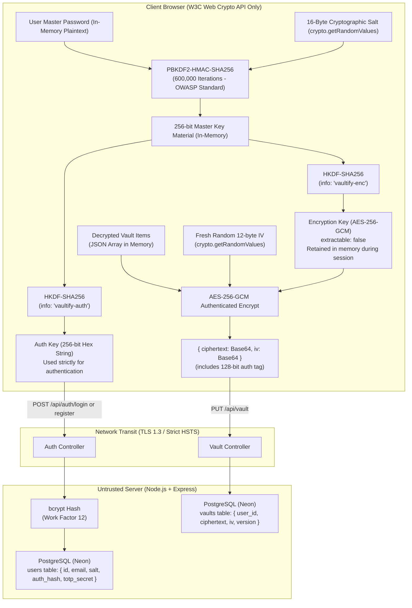

# Vaultify: Comprehensive Security Threat Model & Architectural Analysis

## 1. System Overview & Security Philosophy

**Vaultify** is an enterprise-grade, zero-knowledge password management web application engineered under the foundational security posture that **the host server, database, and network transport are untrusted entities**. 

The server functions strictly as an encrypted blob storage repository. The server never receives, handles, derives, logs, or stores the master password, any encryption keys, or any decrypted vault data.

---

## 2. Cryptographic Key Derivation & Flow Architecture

---

## 3. Cryptographic Decision Defense & Mathematical Guarantees

### 3.1. PBKDF2-HMAC-SHA256 with 600,000 Iterations
* **Rationale**: Complies with the latest OWASP Password Storage Guidelines for PBKDF2-HMAC-SHA256. 
* **Defense Profile**: Drastically increases the computational cost of offline brute-force attacks using GPUs or ASIC clusters. An attacker testing candidate master passwords must calculate 600,000 SHA-256 HMAC rounds per guess, creating a steep computational asymmetry in favor of the defender.

### 3.2. HKDF Domain Separation (RFC 5869)
* **Rationale**: Deriving authentication tokens and encryption keys directly from the same key material creates cryptographic cross-protocol vulnerabilities.
* **Guarantee**: 
  - `vaultify-auth`: Derives a 256-bit key exported as a hex string and sent over HTTPS.
  - `vaultify-enc`: Derives a 256-bit AES-GCM key.
  - **Mathematical Independence**: Even if an adversary intercepts the `Auth Key` or extracts the entire server database, it is computationally infeasible to invert HKDF-SHA256 to derive the Master Key or the `Encryption Key`. The database hash reveals zero information about the vault contents.

### 3.3. Non-Extractable CryptoKey (`extractable: false`)
* **Rationale**: In modern browsers, malicious extensions, XSS injections, or developer tool inspections can attempt to inspect variables in memory.
* **Defense**: The AES-GCM key is imported directly into the browser's native cryptographic module with `extractable: false`. The raw key bytes cannot be read by JavaScript code via `crypto.subtle.exportKey()`, mitigating exfiltration through user-space scripts.

### 3.4. AES-256-GCM Authenticated Encryption with Fresh 12-Byte IVs
* **Rationale**: GCM provides both confidentiality and integrity in a single cryptographic operation.
* **IV Uniqueness**: AES-GCM security relies on never reusing an IV with the same key. A fresh 12-byte (96-bit) cryptographically secure random IV is generated on every single save.
* **Integrity Tag**: A 128-bit authentication tag is verified prior to decryption. Any bit-flip, truncation, or tampering in the ciphertext or IV causes `crypto.subtle.decrypt()` to reject immediately (`OperationError`), preventing padding-oracle attacks and ciphertext manipulation.

### 3.5. Unbiased Rejection Sampling for Password Generation
* **Rationale**: The standard approach (`randomByte % alphabet.length`) introduces **modulo bias** because $256$ is rarely divisible by the size of the character pool. Characters near the beginning of the alphabet have a higher statistical probability of selection.
* **Defense**: Rejection sampling calculates the largest multiple of `alphabet.length` that fits within 256 (`maxValid = 256 - (256 % poolSize)`). Any random byte $\ge maxValid$ is discarded and resampled, guaranteeing mathematically uniform probability across the entire character space.

### 3.6. HaveIBeenPwned (HIBP) k-Anonymity Integration
* **Rationale**: Checking whether passwords have appeared in previous breaches without leaking the password.
* **Implementation**: The client computes the SHA-1 hash locally in memory via `crypto.subtle.digest('SHA-1')`. Only the **first 5 hexadecimal characters** (the prefix) are transmitted to `https://api.pwnedpasswords.com/range/{prefix}`. The API returns a list of matching hash suffixes. The client performs suffix matching entirely within client memory. The password and 35 characters of the hash never leave the browser.

---

## 4. Forgotten Master Password: The Cryptographic Reality & Intentional Security Feature

### 4.1. What happens if a user forgets their master password?
**Their vault data is permanently and irrevocably lost. It cannot be recovered by the user, by Vaultify administrators, or by any law enforcement entity.**

### 4.2. Why this is an intentional, non-negotiable security FEATURE
In traditional centralized architectures, "Forgot Password" workflows rely on:
1. Server-side key storage, OR
2. Customer support override backdoors, OR
3. Dual-key escrow systems.

Each of these mechanisms introduces fatal vulnerabilities:
* **Insider Threats & Compromised Admins**: A rogue database administrator or compromised cloud account could decrypt customer vaults.
* **Subpoenas & Third-Party Extraction**: A centralized entity holding decryption keys can be compelled to decrypt user data.
* **Account Takeover via Email / SMS**: Password resets route security through email providers or SMS SIM swaps, bypassing strong encryption.

In **Vaultify's zero-knowledge architecture**:
* Decryption requires the `Encryption Key`.
* The `Encryption Key` exists only when derived mathematically from the user's master password + per-user salt.
* Because the server never stores or derives the key, **no mathematical mechanism exists to recover data without the master password**.
* **Conclusion**: Irrecoverable data loss in the absence of the master password is the mathematical proof that the system is zero-knowledge.

---

## 5. Comprehensive STRIDE Threat Analysis

| Threat Category | Potential Threat Vector | Vaultify Mitigation & Architectural Defense |
|:---|:---|:---|
| **Spoofing** | Credential stuffing or unauthorized login | Server stores `bcrypt(authKey)` with cost factor 12. Rate limiting (30 requests/15 min) per IP. Mandatory step-up TOTP 2FA. Timing-equalized dummy checks on unknown users. |
| **Tampering** | Database adversary alters stored ciphertext or IV | AES-256-GCM authenticated encryption enforces a 128-bit authentication tag. Any tampering triggers immediate client-side decryption rejection. |
| **Repudiation** | Dispute over vault state updates | Atomic version increments on every `PUT /api/vault` with UTC timestamps. User-scoped transactions prevent state collision. |
| **Information Disclosure** | Server database leak or untrusted cloud provider inspection | Zero plaintext stored at rest. Server holds only `{ ciphertext, iv }`. Master key never leaves client memory. TOTP secrets encrypted with AES-256-GCM. |
| **Denial of Service** | Volumetric payload exhaustion or authentication flooding | Strict 1MB payload limits on incoming JSON. `express-rate-limit` on all `/api/auth/*` routes. Connection pooling with timeout safeguards. |
| **Elevation of Privilege** | Reusing a 2FA pre-auth token on vault endpoints | Scope-separated JWT tokens: `scope: 'pre-auth'` tokens are rejected by `requireAuth` on all vault routes (`code: TWO_FACTOR_REQUIRED`). |

---

## 6. Client-Side Attack Surface Analysis

### 6.1. Browser Memory & Session Lifetime
* No keys, passwords, tokens, or decrypted vault items are ever written to `localStorage` or `sessionStorage`.
* When the user locks the vault or logs out:
  1. The in-memory `CryptoKey` reference in `keyStore` is set to `null`.
  2. The Redux `vaultSlice` state (`items`, `rawCiphertext`, `rawIv`) is purged.
  3. The API bearer token is set to `null`.
* **5-Minute Inactivity Auto-Lock**: An event listener monitors user activity (`mousemove`, `keydown`, `touchstart`, `scroll`). After 5 continuous minutes without interaction, the vault auto-locks and memory is purged.

### 6.2. Clipboard Exposure
* Passwords copied to the clipboard are subject to a **30-second security countdown**.
* After 30 seconds, the browser clipboard is overwritten with an empty string via `navigator.clipboard.writeText('')`, preventing other applications from harvesting copied secrets.

### 6.3. User Enumeration Defense
* Standard servers return `404 Not Found` or a random salt when querying salts for non-existent users, leaking whether an email is registered.
* Vaultify's `/api/auth/salt` returns a **deterministic pseudo-salt** computed via `HMAC-SHA256(email, SALT_PEPPER)`. The response is indistinguishable from real users in structure, timing, and consistency across requests.
